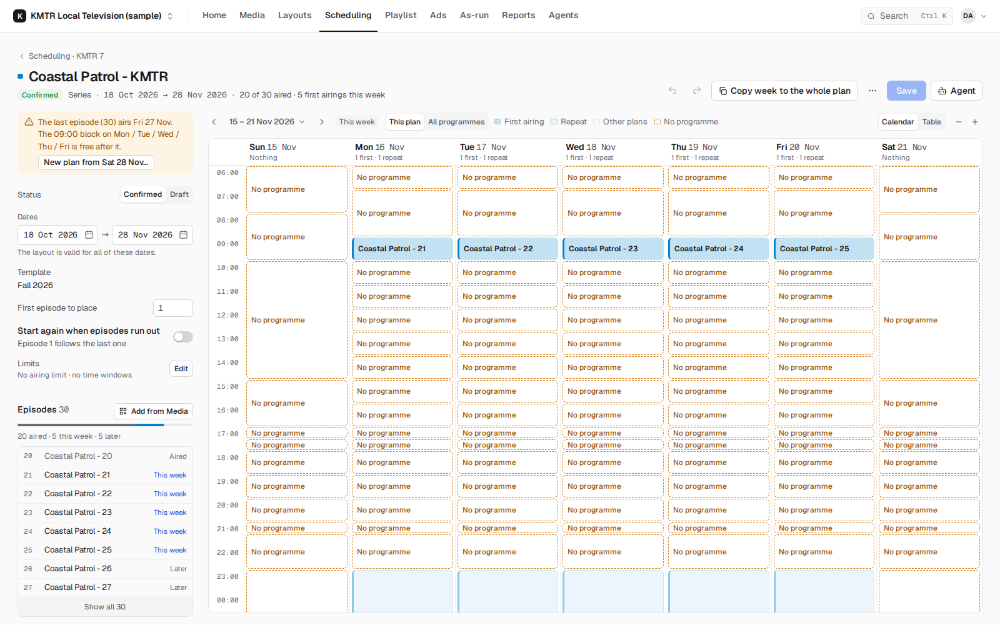
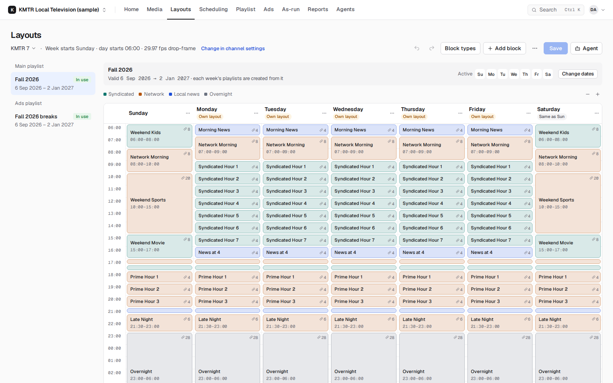
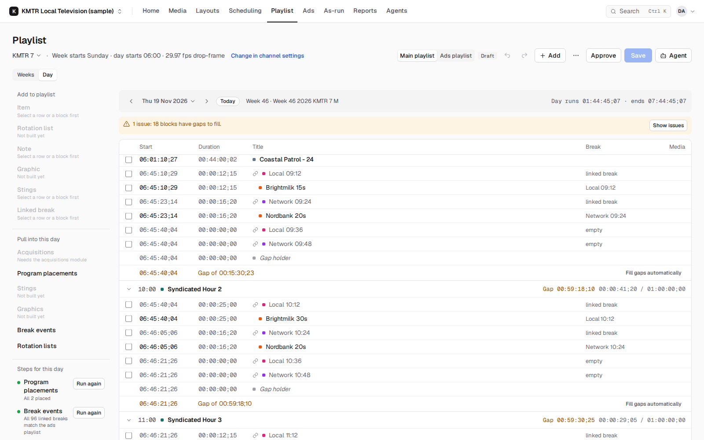
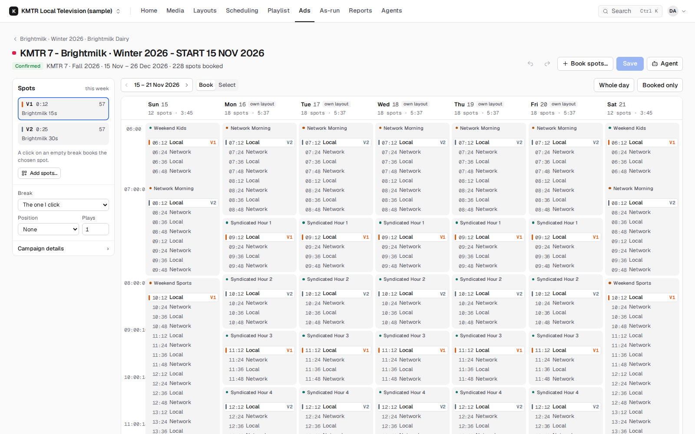
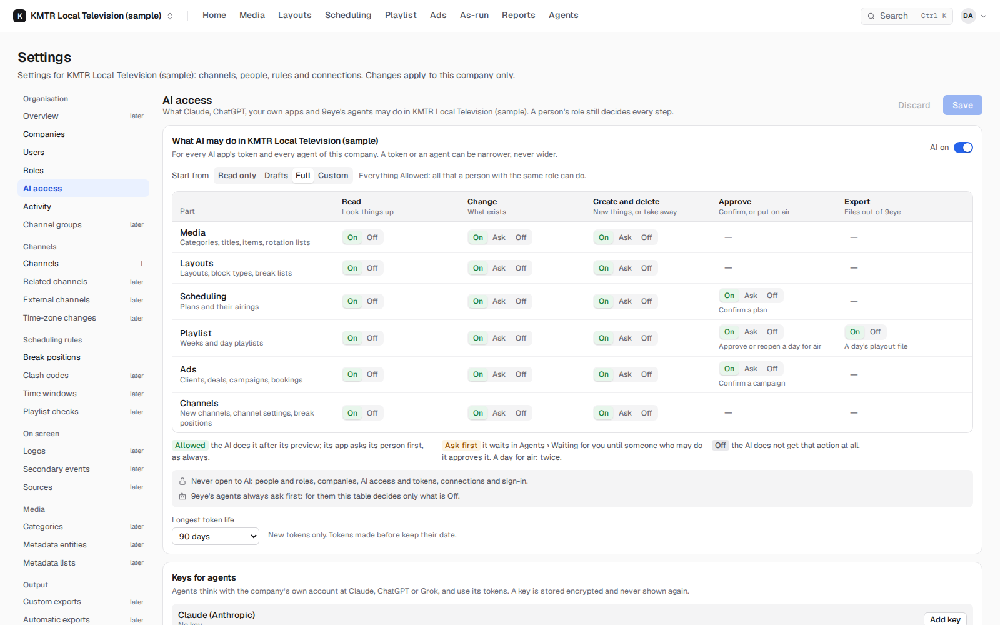
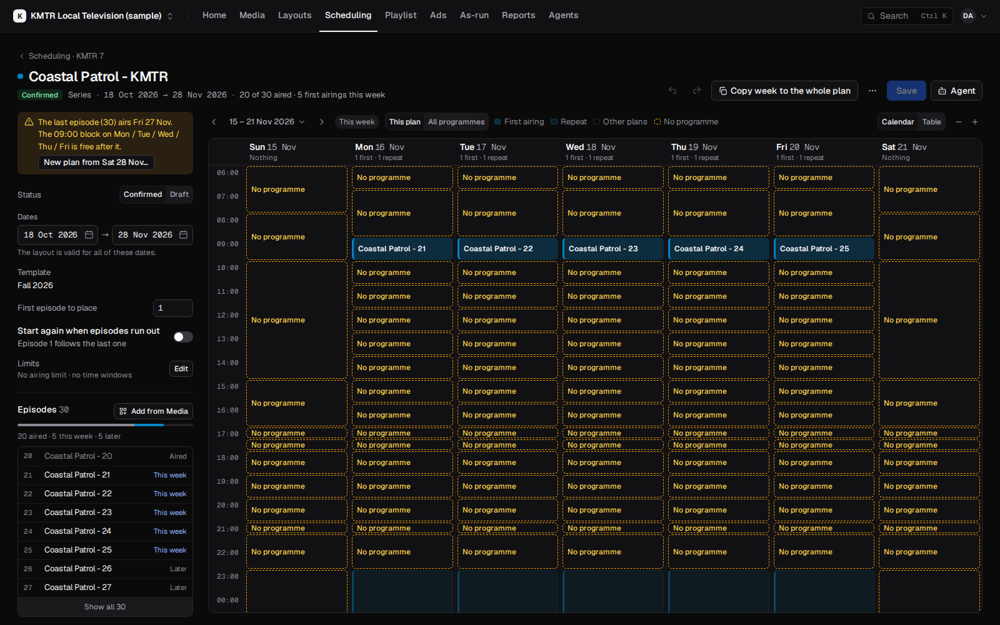
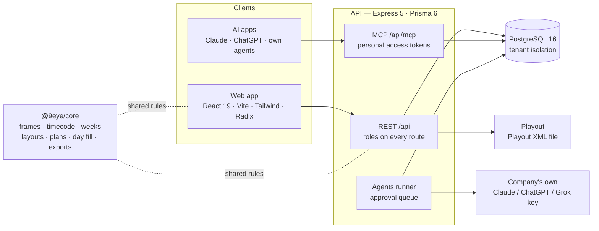

<p align="center">
  
</p>

<h1 align="center">9eye</h1>

<p align="center">
  <strong>Open-source broadcast scheduling and TV traffic software, with AI agents built in.</strong><br>
  Media catalog → layouts → scheduling → frame-accurate playlists → ad booking → export to playout.
</p>

<p align="center">
  <a href="https://github.com/mrtero22/9eye/actions/workflows/ci.yml"></a>
  <a href="LICENSE"></a>
  
  
  
  
  
</p>

<p align="center">
  <a href="https://9eye.org">Website</a> ·
  <a href="#features">Features</a> ·
  <a href="#quick-start">Quick start</a> ·
  <a href="#architecture">Architecture</a> ·
  <a href="docs/decisions/README.md">Design decisions</a> ·
  <a href="CONTRIBUTING.md">Contributing</a> ·
  <a href="#work-with-9eye-studio"><strong>Work with us</strong></a>
</p>

<p align="center">
  <sub>Built and maintained by <a href="https://9eye.org/studio"><strong>9eye Studio</strong></a> — available for broadcast and workflow automation projects worldwide.</sub>
</p>

<p align="center">
  
</p>

---

**9eye** is a multi-tenant platform for TV channels that plan what goes on air: linear channels, FAST
and streaming channels, public broadcasters without ads, and groups that run many channels. It covers
the whole traffic workflow — from the media catalog to the day's playout file — in one calm, fast web
app, and lets AI apps and its own agents do the routine work under the same permissions as people.

- **Frame-accurate by design.** Every length and time is an integer number of frames: 23.976 to
  59.94 fps, drop-frame timecode, broadcast days that start at any hour and run past midnight.
- **Built for every channel, not one company.** Week start, day start, frame rate, time zone, ad
  breaks and export format are channel settings, never code forks.
- **AI that asks first.** An MCP server for Claude, ChatGPT or your own agents, and a team of 9eye
  agents — each action previewed, allowed, held for approval or turned off, part by part.

## Contents

- [Features](#features)
- [Screenshots](#screenshots)
- [Quick start](#quick-start)
- [Architecture](#architecture)
- [Project structure](#project-structure)
- [Testing](#testing)
- [Roadmap](#roadmap)
- [Contributing](#contributing)
- [Work with 9eye Studio](#work-with-9eye-studio)
- [License](#license)

## Features

### Layouts — the channel's week, block by block

Main and ads layouts per channel with valid dates and active weekdays; block types in groups; a week
grid with drag and drop, undo and redo. Ad breaks are linked from the ads layout and applied to many
blocks at once; **Repeat a time range** copies an hour across the day and creates the block types it
needs, all-or-nothing.

### Scheduling — plans for series, programmes, trailers, stings and graphics

A plan places items into a channel's layout blocks over a date range, confirmed or draft. The week
calendar shows first airings and repeats; **Copy week to the whole plan**, quick placement,
**Auto-place** inside allowed time windows, airing limits, shifting episodes, splitting and replacing
plans, and a report per item and week. Conflicts with other plans are named, never hidden.

### Playlist — weeks and frame-accurate days

Weeks are created from the layouts; each broadcast day is a main (and optional ads) playlist of blocks
and events with running start times, gaps and overruns. One click pulls in **programme placements**
(each programme split across its linked breaks), **break events** (the booked spots) and **rotation
lists** that fill the gaps. Issues and steps are listed per day; a day is approved for air and
exported as a **Playout XML** file.

### Ads — clients, deals, campaigns and spot booking

Clients (advertisers and agencies), deals with channels, dates and currency, and one campaign per
channel. Spots are booked on a week board of the channel's real breaks, or in bulk for whole date
ranges; break positions, plays per break, and **Auto-place ads** into the ads playlist with room,
position order and "never back to back" rules. Spots that do not fit are reported with the reason.

### Media — the catalog

Categories → titles → items → cuts → parts, with timecodes in the catalog's frame rate, graphics,
rotation lists, related items, bulk edit and **Create series**.

### AI — an MCP server, a permission table, and a team of agents

- **MCP server** at `/api/mcp` for Claude, ChatGPT, Grok or your own agents, with personal access
  tokens (only their SHA-256 is stored) and 75+ tools named after the work, not the endpoints —
  **[connect an AI app in two steps](docs/mcp.md)**.
- **What AI may do:** one table per company — part × action (Read · Change · Create and delete ·
  Approve · Export), each *Allowed*, *Ask first* or *Off*; tokens and agents can only be narrower.
  Every change has a preview and an undo, and lands in the audit log.
- **Agents:** create any number, give each a job, chat with them or put them in rooms where they hand
  work to each other; every change waits in *Waiting for you* until a person approves it. Agents run
  on the company's own Claude, ChatGPT or Grok key, stored encrypted.

### Platform

Multi-tenant (shared database, tenant isolation in the data layer), roles as module × action ×
channel scope with built-in roles, e-mail and password sign-in (scrypt, session cookie, lock after
five wrong tries), an audit log, secrets encrypted at rest (AES-256-GCM), Light and Dark themes, Calm
and Compact density, and a phone layout with a bottom tab bar.

## Screenshots

The screenshots are taken from the [Docker demo](#try-it-in-one-command-docker): the fictional sample
station *KMTR 7* (29.97 fps drop-frame, week from Sunday), its weeks, programmes and ad campaigns all
made by 9eye's own MCP tools. Every name is made up.

| | |
|---|---|
|  |  |
| **Layouts** — a channel's week, block by block | **Playlist** — one day, frame-accurate, with its breaks and spots |
|  |  |
| **Ads** — a campaign's spots on the week's real breaks | **AI access** — Allowed, Ask first or Off, per part and action |

<p align="center">
  <br>
  <em>Every page in Light and Dark, from one design system.</em>
</p>

## Quick start

### Try it in one command (Docker)

A demo image with PostgreSQL, the API, the web app and two sample companies:

```bash
docker build -t 9eye https://github.com/mrtero22/9eye.git
docker run --rm -p 4101:4101 9eye
```

Open http://localhost:4101 and sign in as `demo@9eye.local` / `9eye-demo-password`. The same image
serves the MCP server over stdio for a desktop MCP client: `docker run --rm -i 9eye mcp`
([docs/mcp.md](docs/mcp.md#over-stdio)). The demo has a built-in password and token — use it to look
around, not for real data.

### Run it from the source

Requirements: **Node.js 20.19+**, npm, and **Docker** (for PostgreSQL). Everything binds to `127.0.0.1`.

```bash
git clone https://github.com/mrtero22/9eye.git && cd 9eye
cp .env.example .env          # set NINEEYE_DB_PASSWORD (also in both URLs) and NINEEYE_SECRET_KEY:
                              #   openssl rand -base64 32
npm install
npm run db:up                 # PostgreSQL 16 in Docker on 127.0.0.1:5442
npm run db:migrate
npm run db:seed               # two sample companies with their channels

# the first person who can sign in (asks for the password twice)
npm -w @9eye/api run user:create -- you@example.com "Your Name" --admin

npm run dev:api               # API on http://127.0.0.1:4100
npm run dev:web               # web app on http://127.0.0.1:4101 — sign in there
```

More people: `user:create -- <email> "<name>" --company <short name> --role <role>` (roles:
company-admin, traffic, scheduler, sales, viewer), or add them in **Settings › Users** and set their
password with `npm -w @9eye/api run user:password -- <email>`. An MCP token for an AI app:
`npm -w @9eye/api run token -- create <email> <company short name> "<name>" [days]`.

## Architecture



The rules that must agree between screen and server — timecode, weeks, layouts, plan operations,
filling a day, export files — live once in `packages/core` and are used by both. Each decision behind
the design is written down in [`docs/decisions/`](docs/decisions/README.md).

## Project structure

| Folder | What |
|---|---|
| [`packages/core/`](packages/core/) | Frames and timecode, weeks, layout, plan, playlist and export rules — shared by API and web |
| [`apps/api/`](apps/api/) | Express + Prisma API, MCP server and agents runner; schema in `prisma/` |
| [`apps/web/`](apps/web/) | React web app; `src/ui` is the design system, `e2e/` the Playwright tests |
| [`apps/site/`](apps/site/) | The public website (Astro, static) |
| [`docs/`](docs/) | [Decisions](docs/decisions/README.md), [data model](docs/design/data-model.md), [UI foundation](docs/design/ui-foundation.md), page docs and mockups |
| [`scripts/`](scripts/) | Repository checks |

## Testing

```bash
npm test                      # name check + core, API (on the nineeye_test database) and web unit tests
npm run typecheck
npm -w @9eye/web run e2e      # Playwright browser tests against the running app (a throw-away company)
```

300+ unit and integration tests cover the core rules and the API; 17 Playwright suites drive the real
app in a browser. API tests run on their own database, one file at a time.

## Roadmap

- **As-run and reconciliation:** air logs matched against the playlist; broadcast history from them.
- **More exports:** BXF and the other playout formats, XMLTV EPG.
- **MAM adapters:** media status from any MAM through an adapter.
- **Sign-in security:** two-step sign-in, suspend and resume, view as (read only), channel sets.
- **Sales and billing:** prices, ad rates and invoices.

## Contributing

Contributions are welcome — read [CONTRIBUTING.md](CONTRIBUTING.md) first. Security issues: please
follow [SECURITY.md](SECURITY.md) instead of opening a public issue. Everyone taking part follows the
[Code of Conduct](CODE_OF_CONDUCT.md).

## Work with 9eye Studio

9eye is designed, built and maintained by **[9eye Studio](https://9eye.org/studio)**, a small studio
for workflow automation and AI agents, with its deepest work in TV and media operations. If 9eye
shows the kind of work your team needs, we take on projects worldwide:

| What we build | For example |
|---|---|
| **Broadcast automation** | Playlist QC before playout, ad traffic that places itself, airing patterns rebuilt by an agent, export files your playout accepts |
| **AI agents and MCP servers** | Agents on Claude, ChatGPT or a local model that do one job, connected to your systems through MCP, with a person approving what matters |
| **Validators and data checks** | Every file, export or playlist checked against your rules before it goes out, with a report that points to each problem |
| **Automation without an API** | Chrome extensions and browser automation inside the web apps your team already uses |
| **Integrations and pipelines** | Data typed twice today moving on its own between sales, traffic, spreadsheets and databases |
| **9eye for your channels** | A hosted 9eye, a rollout with your data, or features your channels need |

**How a project works:** a free 30-minute call → a fixed quote with scope, price and date → short
build cycles with demos on your real screens → testing on real cases → hand-over of the source code
with a guide. Remote, in English, NDA on request.

<p>
  <a href="mailto:studio@9eye.org"></a>
  <a href="https://9eye.org/studio#start"></a>
  <a href="https://www.linkedin.com/company/9eye-studio/"></a>
</p>

9eye itself is free to self-host under the AGPL-3.0 license below.

## License

[GNU Affero General Public License v3.0](LICENSE) (AGPL-3.0-only): you may use, change and host 9eye;
if you run a changed copy as a service for others, publish your changes under the same license.
