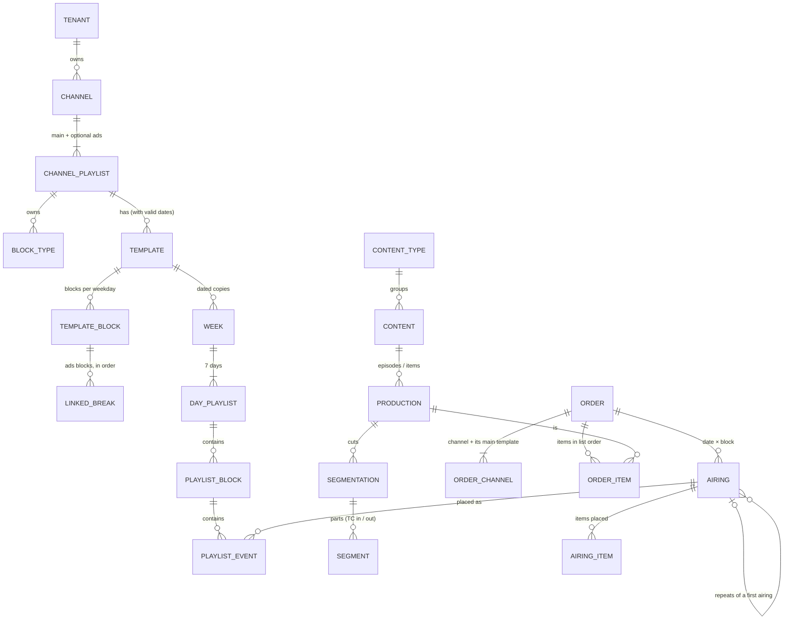

# Data model

The tables live in [`apps/api/prisma/schema.prisma`](../../apps/api/prisma/schema.prisma); every model
and field there says what it is. Rules shared by the API and the web app are in `packages/core/src/`.
Code comments point to the sections below by number.

## 0. Rules that apply to every table

- **Tenant isolation (0007):** every company-owned row has `tenant_id`; enforced in the data layer.
  Platform tables (tenants, users) are the only ones without it.
- **Time (0004):** durations and offsets are **integer frames**. A time inside a broadcast day is an
  offset in frames from the channel's broadcast-day start, so 25-hour daylight-saving days and the
  after-midnight tail need no special case. Calendar dates are plain `date` (the broadcast day's
  label), never timestamps with a zone.
- **IDs:** UUID v7 primary keys (`packages/core/src/ids.ts`). Every editable aggregate has a
  `version` integer for optimistic locking (two people editing one playlist).
- **History:** an append-only `audit_event` table records who changed what. Deletes are soft
  (`deleted_at`) where other records may point at the row.
- **No customer-specific columns (0001, 0005):** anything that differs per company is a typed
  setting, a rule or a plugin configuration.
- **Bulk operations are all-or-nothing:** one transaction; on any conflict nothing is written.

## 1. The picture

## The parts and their Prisma models

| § | Part | Models |
|---|---|---|
| 2 | Platform and tenancy (0007, 0021, 0023) | `Tenant`, `User`, `Membership`, `Role`, `RoleGrant`, `RoleScope`, `Session`, `RecoveryCode`, `AccessToken`, `AuditEvent`, `Connection` |
| 3 | Channels (0004, 0005) | `Channel` |
| 4a, 4b | Catalog and media | `ContentType`, `Content`, `Production`, `Segmentation`, `Segment`, `Source`, `LogoType`, `Logo`, `SecondaryAction`, `CustomField`, `RotationList`, `RotationListItem`, `GraphicSource`, `GraphicObject`, `GraphicTemplate`, `TimeWindow`, `TimeWindowRange`, `ProductCode`, `CatalogRelation` |
| 5 | Channel playlists, block types and templates (0016, 0018) | `ChannelPlaylist`, `BlockGroup`, `BlockType`, `Template`, `TemplateBlock`, `LinkedBreak`, `BreakList` |
| 6 | Weeks and day playlists | `Week`, `DayPlaylist`, `PlaylistBlock`, `PlaylistEvent` |
| 7, 7b | Orders (the Scheduling page) and ads | `Order`, `OrderChannel`, `OrderItem`, `Airing`, `AiringItem`, `Client`, `Contract`, `ContractChannel`, `BreakPosition` |
| — | AI apps and agents (0023–0025) | `AiProvider`, `Agent`, `AgentMemory`, `AgentSkillVersion`, `AgentRoom`, `AgentMessage`, `AgentRun`, `AgentChange`, `AgentRoutine` |
